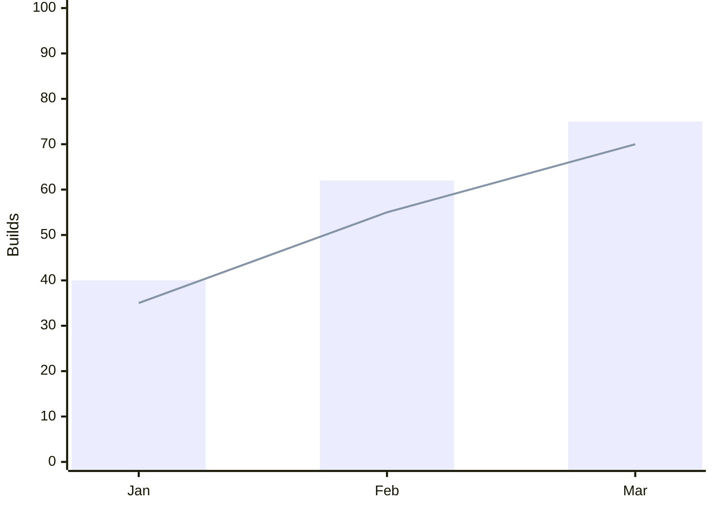
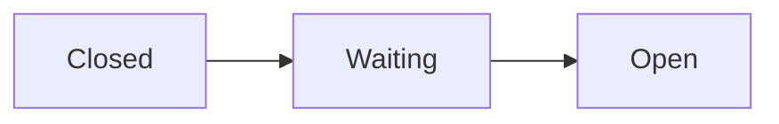

# chart

Renders Mermaid diagrams and charts through the pinned `pele` package and embeds the SVG in a `show_widget` call.

## Procedure

1. Write the Mermaid source. Put `accTitle:` (and `accDescr:` when the picture needs more than its title) on the line after the diagram keyword. Pele turns them into the SVG's `<title>` and `<desc>`, which stand in for the widget's screen-reader heading. `block`, `eventmodeling`, `sankey-beta` and `venn-beta` reject both lines with a parse error, so leave them out there; `ishikawa-beta`, `kanban` and `mindmap` drop both, and C4 drops `accTitle`.
2. Render it:

   ```bash
   bun ~/.claude/skills/chart/scripts/render.ts <<'EOF'
   flowchart LR
     accTitle: Request lifecycle
     A[Client] --> B[API] --> C[(Database)]
   EOF
   ```

3. On exit 1, stderr names the error and, where known, the line and column. Fix the source and rerun.
4. Pass stdout verbatim as `widget_code` to `show_widget`. Write the explanation in the reply, outside the tool call.

## Picking the type

The first line names the type, so pick it by what the picture has to show. Pele renders every type Mermaid 12.1 registers. Its [gallery](https://pele.run/examples) holds a working source for each, a good start when the syntax is unfamiliar.

| To show                                                        | First line |
| -------------------------------------------------------------- | ---------- |
| A trend over time, or values across categories                 | `xychart-beta` (`line`, `bar`) |
| Shares of one whole                                            | `pie` |
| Shares nested in groups                                        | `treemap-beta` |
| Quantities flowing between stages                              | `sankey-beta` |
| Several measures per item, side by side                        | `radar-beta` |
| Items on two axes, such as effort against impact               | `quadrantChart` |
| Overlap between sets                                           | `venn-beta` |
| Steps, branches and loops                                      | `flowchart` |
| One process across roles or teams                              | `swimlane-beta` |
| An agent or pipeline's stages, in collapsible groups           | `agentflow-beta` |
| Messages between parties, in order                             | `sequenceDiagram` |
| States and the transitions between them                        | `stateDiagram-v2` |
| Commands, events and read models of an event-sourced system    | `eventmodeling` |
| A user's steps, each with a satisfaction score                 | `journey` |
| Actors and the use cases they reach                            | `usecase-beta` |
| Tables and their relations                                     | `erDiagram` |
| Types, their members and inheritance                           | `classDiagram` |
| Services, databases and the links between them                 | `architecture-beta` |
| A system at one C4 level                                       | `C4Context`, `C4Container`, `C4Component`, `C4Dynamic`, `C4Deployment` |
| Boxes on an explicit grid                                      | `block` |
| Requirements and what satisfies or verifies them               | `requirementDiagram` |
| Ideas branching from one centre                                | `mindmap` |
| A file tree                                                    | `treeView-beta` |
| The bit layout of a packet or header                           | `packet` |
| A grammar                                                      | `railroad-ebnf-beta`, or `railroad-beta` for its own notation |
| Tasks with dates, durations and dependencies                   | `gantt` |
| Dated events without durations                                 | `timeline` |
| Branches, commits and merges                                   | `gitGraph` |
| Work items by status                                           | `kanban` |
| Causes of one effect, by category (fishbone)                   | `ishikawa-beta` |
| A value chain by visibility and evolution                      | `wardley-beta` |
| Situations sorted into clear, complicated, complex and chaotic | `cynefin-beta` |

## Charts

A chart takes the same procedure as a diagram.



Series take the host's categorical palette in source order: the first `bar` or `line` (or pie slice) gets series 1, the next series 2. Past eight series the colours repeat, so fold the rest into "Other".

## Colouring nodes by meaning

Give a node or subgraph one of four role classes, `accent`, `success`, `warning` or `danger`, with `class A,B success` or `A:::success`. It needs no `classDef`: `render.ts` paints the role with the widget's `--bg-*`, `--border-*` and `--text-*` tokens, so it follows light and dark mode. Pele rejects `var()` inside `classDef` and `style`, so a role class is the only themed colour a source can set.



## Wide diagrams

A diagram too wide to stay legible at the widget's width goes into a zoomable viewport instead of shrinking; a narrower one keeps the plain centred output. The viewport opens at 1:1 against the top-left corner, where a top-down or left-to-right flow starts.

- Toolbar, bottom-right: zoom out, the scale readout, zoom in, fit to view, actual size.
- Pointer: drag to pan; ctrl/cmd+scroll or pinch to zoom. A plain scroll passes through to the chat.
- Keyboard: focus the viewport, then arrows pan, `+` and `-` zoom, `0` returns to 1:1, `f` fits.

`render.ts` inlines the zoom script, so nothing loads at view time. Each render takes its own random `mmd-…` id prefix, so several diagrams can share one reply.

## Rules

- Render every diagram through `render.ts`, so its code comes from the lockfile rather than from jsDelivr, esm.sh or unpkg at view time. This rule replaces the `show_widget` guide's advice to load mermaid.js from esm.sh for ER and class diagrams.
- Leave the output as it is. The wrapper `div` maps Pele's `--pele-*` variables onto the widget's theme variables, so the diagram follows light and dark mode. Hex colours added by hand break dark mode.
- Pele lays out once, at render time. Live relayout to the container width needs Pele's browser `mount()`, which this skill gives up along with the CDN. Zoom makes up for the fixed width.

## Upgrading Pele

The version lives in `scripts/package.json`, and `bun.lock` pins its sha512. To bump it, run `bun add pele@<version>` in `scripts/`. `~/.bunfig.toml` accepts only releases at least 7 days old. Then run `bun test` there.
