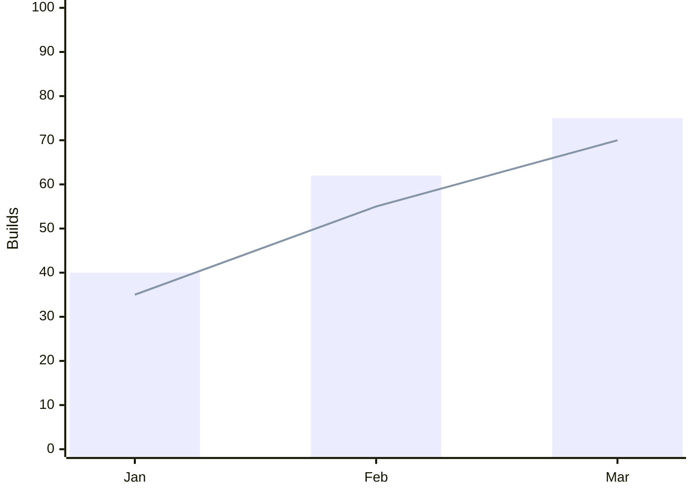
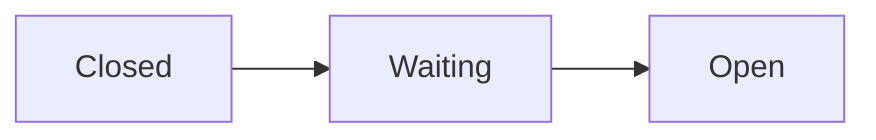

# chart

Renders Mermaid diagrams and charts through the pinned `pele` package and embeds the SVG in a `show_widget` call.

## Procedure

1. Write the Mermaid source. Put `accTitle:` (and `accDescr:` when the title is not enough) on the line after the diagram keyword. Pele turns them into the SVG's `<title>` and `<desc>`, which stand in for the widget's screen-reader heading.
2. Render it:

   ```bash
   bun ~/.claude/skills/chart/scripts/render.ts <<'EOF'
   flowchart LR
     accTitle: Request lifecycle
     A[Client] --> B[API] --> C[(Database)]
   EOF
   ```

3. On exit 1, stderr names the error and, where known, the line and column. Fix the source and rerun.
4. Pass stdout verbatim as `widget_code` to `show_widget`. Write the explanation in the reply, outside the tool call.

## Charts

A chart takes the same procedure; its keyword picks the type: `xychart-beta`, `pie`, `quadrantChart`, `sankey-beta`, `radar-beta`, `treemap-beta`, `venn-beta`.



Series take the host's categorical palette in source order: the first `bar` or `line` (or pie slice) gets series 1, the next series 2. Past eight series the colours repeat, so fold the rest into "Other".

## Colouring nodes by meaning

Give a node or subgraph one of four role classes, `accent`, `success`, `warning` or `danger`, with `class A,B success` or `A:::success`. It needs no `classDef`: `render.ts` paints the role with the widget's `--bg-*`, `--border-*` and `--text-*` tokens, so it follows light and dark mode. Pele rejects `var()` inside `classDef` and `style`, so a role class is the only themed colour a source can set.



## Wide diagrams

A diagram too wide to stay legible at the widget's width goes into a zoomable viewport instead of shrinking; a narrower one keeps the plain centred output. The viewport opens at 1:1 against the left edge, where a left-to-right flow starts.

- Toolbar, bottom-right: zoom out, the scale readout, zoom in, fit to view, actual size.
- Pointer: drag to pan; ctrl/cmd+scroll or pinch to zoom. A plain scroll passes through to the chat.
- Keyboard: focus the viewport, then arrows pan, `+` and `-` zoom, `0` returns to 1:1, `f` fits.

`render.ts` inlines the zoom script, so nothing loads at view time. Each render takes its own random `mmd-…` id prefix, so several diagrams can share one reply.

## Rules

- Load nothing from a CDN for diagrams. This skill exists so the rendering code comes from the lockfile, not from jsDelivr, esm.sh or unpkg at view time. It also replaces the `show_widget` guide's advice to load mermaid.js from esm.sh for ER and class diagrams.
- Leave the output as it is. The wrapper `div` maps Pele's `--pele-*` variables onto the widget's theme variables, so the diagram follows light and dark mode. Hex colours added by hand break dark mode.
- Pele lays out once, at render time. Live relayout to the container width needs Pele's browser `mount()`, which this skill gives up along with the CDN. Zoom covers the width a fixed layout cannot.

## Upgrading Pele

The version lives in `scripts/package.json`, and `bun.lock` pins its sha512. To bump it, run `bun add pele@<version>` in `scripts/`. `~/.bunfig.toml` refuses releases younger than 7 days. Then run `bun test` there.
